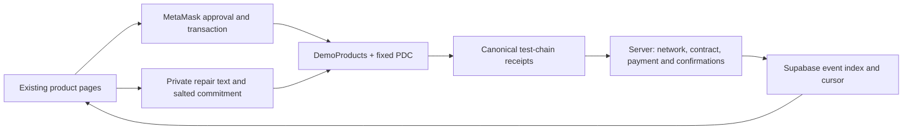

# PDC product settlement and operations

The independent `DemoProducts` registry supports free inventory handovers and
designated-buyer PDC offers. `PRODUCT_BACKEND=database` remains the default. Enabling
`chain` selects a separate registry/read model; existing database products are not
automatically imported or assigned new chain ownership. Use newly registered demo
products when rehearsing the chain workflow.

## Contracts and rules

- Identifiers are UUID v4 encoded as `bytes16`; the contract enforces the UUID
  version/variant. Chain serials are trimmed printable ASCII, case insensitive,
  up to 120 bytes. Models and warranty limits preserve the existing form limits.
- Roles are self-selected **once** through `enroll`. This is the same classroom
  trust assumption as profile onboarding, not certification of real manufacturers.
  Website and chain roles must agree. No admin can later change a wallet's role.
- Manufacturer → retailer → customer → customer is enforced in the contract.
- One open transfer or warranty claim per product. A pending sale blocks claims;
  submitted/approved claims block free and paid handovers.
- `createPaidOffer` fixes product, seller, designated buyer, PDC base-unit price
  and expiry. No AMM oracle or automatic fiat conversion is involved.
- `acceptTransfer` rejects paid offers. `acceptPaidOffer` checks the buyer, pending
  status, expiry and unchanged seller, then uses `SafeERC20.transferFrom` in the
  same transaction as ownership and initial warranty changes. Failure reverts all
  settlement effects. Successful earlier token approvals are separate transactions.
- The first retailer-to-customer acceptance starts warranty, including a paid
  acceptance. Resales preserve that start and all used claims. A repair consumes
  one claim only on completion. A valid claim can be completed after expiry.
- An expired offer cannot be accepted. Its seller can cancel or its buyer can
  reject it to unblock the product. Free handovers have no expiry.
- Chain payment and digital ownership do not prove physical delivery.

## Local rehearsal

1. `npm ci`, `npm run contracts:build`, `npm run contracts:test`, `npm test`.
2. Start `npm run chain:node` in a separate terminal. An old journal from a stopped
   Hardhat instance must be explicitly archived before a fresh local deployment.
3. Run `npm run chain:deploy-tokens`, `npm run chain:deploy-amm`, then
   `npm run chain:deploy-products`. Each uses the same resumable deployment journal.
   Product deployment also records `productsFromBlock`; ABI is generated from the
   compiled source by `contracts:build`.
4. A team member applies `202610160001_demo_chain.sql` after the initial setup.
   The complete statements, execution order and validation are delivered in the
   repository SQL issue. The application never executes cloud DDL.
5. In `.env.local`, set `DEMO_DEPLOYMENT_FILE=deployments/31337.json`,
   `DEMO_PUBLIC_RPC_URL=http://127.0.0.1:8545`, and `PRODUCT_BACKEND=chain`, alongside
   normal Supabase settings. Start/restart `npm run dev`.
6. Use five disposable test wallets as manufacturer, retailer, two customers and
   service center. Each completes its website profile and clicks **Activate role**
   in the workspace banner. Recipients need both a profile and an active role.
7. Register a product, hand inventory to the retailer, then create a PDC sale to
   one customer with a future expiry. On Transfers, that customer reviews the
   exact price/seller/spender, approves the exact amount, then separately clicks
   **Pay PDC and accept**. Verify wallet balances and passport payment evidence.
8. Submit a warranty request, approve it as the service center, and record repair
   completion. Verify the allowance changes only on completion. Resell and verify
   original warranty and service history persist.

The deployment scripts use shell environment variables; they do not automatically
load Next's `.env.local`. Do not send private keys in chat, issues or source files.
The local Hardhat wallets/keys must never be funded on a live network.

## Read model, privacy and recovery

`POST /api/chain/sync` accepts an optional transaction hash, not user-supplied event
or balance data. Before writing it verifies the network, registry version/payment
token, successful canonical receipt, contract address and confirmation count. Paid
ownership events also require a matching PDC `Transfer` in the same receipt.

Sepolia indexing waits for two confirmations (local Hardhat uses one). This is
not economic finality. Cursor anchors detect a changed chain; the small classroom
index is cleared and rebuilt from `productsFromBlock` on a reorg. Private text is
retained, but becomes visible only when a matching canonical event exists. Current
ownership/warranty are read from the contract before serving private product data.

Each batch scans at most 2,000 blocks, verifies actual receipts and atomically
inserts events plus cursor. An optimistic cursor check prevents concurrent workers
from skipping/recounting events. Event identity includes chain, registry, hash and
log index. Repeating synchronization cannot create another payment.

Product writes automatically request synchronization after confirmation. If a
request times out, check the receipt in Demo wallet, then use **Sync products** and
reload; do not repeat a payment or registration to repair an index delay. Direct
contract calls made outside the website can be picked up by the same sync path.

Repair description/rejection/resolution text is first stored server-side with a
random 32-byte nonce. Its commitment binds network, registry, actor, product,
claim, kind and body. Only that commitment goes on chain. The server checks it
again when returning text. The customer/assigned center can access their claim;
the current owner can see completed repair notes. Public verification returns
masked ownership and payment proof, with no private notes or user IDs. Calls made
outside the website may have no recoverable private text; the chain repair record
and allowance still exist. Images remain public off-chain assets, updated only by
the chain manufacturer with the existing compare-and-swap upload protection.

All four `dapp_demo_*` tables and both ingestion/reset functions are service-role
only. Existing six tables, functions and policies are preserved. Switching back to
`database` changes the selected dataset; it does not undo any chain transactions.

For the comparison with issue #1, installation-order tests and the read-only SQL
acceptance check, see [database compatibility and execution](database-compatibility.md).

## Deployment and maintenance

- Contracts are deployed separately from website CI. Save the manifest, journal,
  generated ABI, compiler/package lock, addresses, version and deployment block.
  Website releases reuse them; never delete a Sepolia journal to force a retry.
- The Sepolia contracts were deployed on 2026-10-18. Reuse the public addresses,
  starting blocks and RPC in [the reviewed manifest](../config/demo-chain.sepolia.json)
  and retain the original deployment journal. Website CI injects this configuration;
  do not redeploy contracts to retry a website release. Keep `PRODUCT_BACKEND=database`
  until the original Supabase project's seven SQL acceptance checks, deployment
  configuration and wallet integration have been verified. The cloud SQL checks
  remain unconfirmed; the local SQL compatibility check does not establish them.
- Update the `dev/<feature>` branch against `release`, resolve conflicts and pass
  CI, then send the PR to the group leader. The leader, whose account has deployment
  permission for the Vercel project, performs the final merge. Confirm production
  readiness and the live chain configuration after that release.
- Configure a random server-only `DEMO_INDEXER_TOKEN` of at least 32 characters.
  With matching shell `DEMO_INDEXER_TOKEN` and `DEMO_APP_URL`, run
  `npm run chain:sync`. It performs up to 20 batches and reports remaining backlog.
  Repository **Sync product events** workflow can be manually dispatched after
  setting repository secret `DEMO_INDEXER_TOKEN` and variable `DEMO_APP_URL`.
  No cron, automatic contract redeploy or automatic minting is installed.
- Watch the cursor `next_block`/`updated_at`, RPC errors, receipt/index lag and
  balance/allowance failures. Retry from the saved cursor, not from arbitrary
  user-supplied blocks. On reorg, let the verified reset path rebuild the index.
- Back up Supabase (including salted private text) and public deployment manifests.
  A lost event index can be rebuilt from RPC history; lost private bodies/nonces
  cannot be reconstructed from on-chain hashes. Keep unused prepared text only as
  long as the team's retention policy requires. Do not delete referenced bodies
  while users still need their repair records.
- The query reducer caps a classroom request at 10,000 events; dense RPC batches
  over 1,000 logs need a smaller scan implementation before scaling. For a public
  production service replace this bounded reducer with paged materialized views,
  deeper finality policy, RPC failover/rate limits and monitoring appropriate to its
  load. The deployment is not claimed to be audited or suitable for real funds.

## Verification boundaries

Contract tests run actual bytecode. PostgreSQL tests run the actual migration
twice and enforce permissions/transaction behavior. Service integration tests join
actual Hardhat receipts, SQL and the production read-model/privacy functions, with
identity/SDK boundaries mocked. Browser integration uses real chain transactions
and PostgreSQL event reduction, with HTTP identity/query fixtures. No test adds a
production login bypass or writes to cloud Supabase.
